<div align="center">
  
  
  # Abhedya Foundation Web Application
  ### অভেদ্য ফাউন্ডেশন - অফিসিয়াল ওয়েবসাইট ও পোর্টাল
  
  <p>
    A modern, bilingual, full-featured web application and content management platform for <strong>Abhedya Foundation</strong>, empowering non-profit humanitarian initiatives, fundraising campaigns, community activities, and donor management.
  </p>

  [](https://php.net)
  [](https://laravel.com)
  [](https://vitejs.dev)
  [](LICENSE)
</div>

---

## 🌟 Key Features

### 🌐 Public Portal
- **Bilingual Interface**: Full bilingual support for **বাংলা (Bangla - Default)** and **English**, complete with a dynamic language switch toggle.
- **Projects & Activities**: Showcases ongoing and completed initiatives categorized by status (*Planning*, *Ongoing*, *Completed*) with district locations and detailed progress.
- **Fundraising Campaigns**: Goal-oriented donation drives with financial targets (BDT), real-time progress bars, and timeline updates.
- **Multi-Channel Donations**: Direct contribution gateway supporting **bKash**, **Nagad**, **Rocket**, and **Bank Transfer** with manual transaction ID verification.
- **Photo Gallery & Media**: Categorized photo albums and high-resolution picture galleries from ground activities.
- **Blog & Newsroom**: Press releases, stories of impact, and regular community announcements.
- **Contact Center**: Interactive contact forms with spam throttling and admin dashboard integration.
- **SEO & Discoverability**: Dynamic XML Sitemap (`/sitemap.xml`), custom `robots.txt`, and social OpenGraph meta tags.

### 🛡️ Admin & Staff Portal (`portal.abhedyafoundation.org`)
- **Subdomain Routing**: Dedicated staff portal isolated on a dedicated subdomain (`portal.*`) with automatic redirect guards.
- **Role-Based Access Control (RBAC)**: Fine-grained permissions powered by Tyro Dashboard (`super-admin`, `admin`, `editor`, `user`).
- **Donation Verification**: Verification workflow to confirm donor transaction IDs, approve amounts, and attach funds to specific campaigns.
- **Dynamic Content Management (CRUD)**: User-friendly web management for projects, campaigns, blogs, albums, and site parameters.
- **Security & Authentication**: Two-Factor Authentication (2FA), OTP login, audit logs, and brute-force lockout safeguards.

---

## 👥 User Roles & Access Matrix

| Role | Slug | Capabilities | Access Area |
| :--- | :--- | :--- | :--- |
| **Super Admin** | `super-admin` | Full control: Manage staff, role assignments, system settings, mail servers, and reports. | Complete Portal |
| **Administrator**| `admin` | User management, financial verification, donation audits, and content publishing. | Staff Portal |
| **Editor** | `editor` | Publish and edit blog articles, campaigns, projects, gallery photos, and view donation records. | Content Modules |
| **User / Member**| `user` | Standard member account with view-only access. | Public / Member Area |

---

## 🛠️ Technology Stack

- **Backend**: Laravel 11.x (PHP 8.3)
- **Database**: MySQL 8.0 / MariaDB (InnoDB, UTF-8 mb4)
- **Frontend**: Blade Templating, Tailwind CSS, Alpine.js / Vanilla JavaScript, Vite
- **Administration**: Tyro Dashboard & Tyro Login
- **Web Server**: LiteSpeed / Nginx / Apache with mod_rewrite

---

## 🚀 Local Development Setup

Follow these steps to run the application on your local machine:

### 1. Prerequisites
- [PHP](https://www.php.net/) >= 8.3 with extensions: `pdo_mysql`, `mbstring`, `fileinfo`, `gd`, `openssl`, `curl`
- [Composer](https://getcomposer.org/) >= 2.x
- [Node.js](https://nodejs.org/) >= 18.x and npm
- [MySQL](https://www.mysql.com/) (XAMPP, Laragon, or standalone)

### 2. Clone Repository & Install Dependencies
```bash
git clone https://github.com/niloyahsan1/abhedya_foundation_website.git
cd abhedya_foundation_website

# Install PHP dependencies
composer install

# Install Frontend dependencies
npm install
```

### 3. Environment Configuration
Copy the template configuration:
```bash
cp .env.example .env
```
Generate an application key:
```bash
php artisan key:generate
```

Configure your local database credentials in `.env`:
```env
DB_CONNECTION=mysql
DB_HOST=127.0.0.1
DB_PORT=3306
DB_DATABASE=abhedya_foundation
DB_USERNAME=root
DB_PASSWORD=""
```

### 4. Database Setup
Create an empty database named `abhedya_foundation` in MySQL, then import the database schema:
```powershell
# Using MySQL CLI:
mysql -u root -p abhedya_foundation < abhedya_database.sql

# Or using Laravel migrations:
php artisan migrate
```

### 5. Create Storage Symlink
```bash
php artisan storage:link
```

### 6. Build Assets & Start Server
Build the frontend assets:
```bash
npm run build
# Or run with live file-watching during development:
npm run dev
```

Start the local server:
```bash
php artisan serve
```

### 7. Accessing Local Endpoints
- **Public Website**: [http://localhost:8000](http://localhost:8000)
- **Staff / Admin Portal**: [http://portal.localhost:8000](http://portal.localhost:8000)  
  *(Modern browsers automatically resolve `*.localhost` to 127.0.0.1 without needing `hosts` file modification)*

---

## 🚢 Production Deployment (cPanel Shared Hosting)

### Server Architecture
- **Production URL**: `https://abhedyafoundation.org`
- **Staff Portal URL**: `https://portal.abhedyafoundation.org`
- **PHP Version**: 8.3 (ea-php83)

### Updating Production
1. **Compile Assets Locally**:
   ```powershell
   npm run build
   ```
2. **Upload Updates**:
   Upload modified files via cPanel File Manager or upload an update zip (excluding `.git`, `node_modules`, and local `.env`).
3. **Clear Caches on Live Server**:
   Visit your secure setup route in your browser:
   ```text
   https://abhedyafoundation.org/cpanel-setup-run?key=abhedya2026
   ```

---

## 🔒 Security Best Practices

- **Environment Protection**: Local `.env` files and deployment zips are strictly ignored via `.gitignore`.
- **Debugging**: Ensure `APP_DEBUG=false` in the live production `.env`.
- **Directory Permissions**: Keep `storage/` and `bootstrap/cache/` writable (`775`).

---

## 📄 License & Organization

This web application is developed for **Abhedya Foundation (অভেদ্য ফাউন্ডেশন)**.  
All intellectual property and operational rights belong to the organization.
